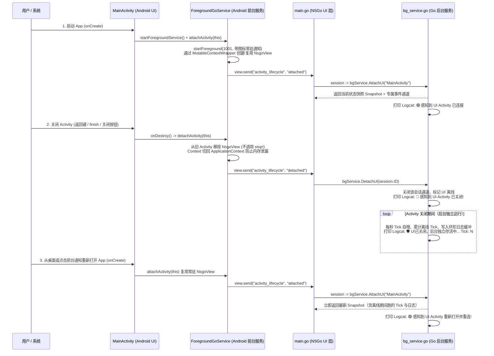

# NSGo 外层 Android 宿主工程 + 前台常驻 Go Service 实现方案规格说明书

## 一、 核心设计原则：零侵入 NSGo 库（官方 `-embed` 模式）

在实际业务开发中，不应修改底层 UI 引擎库（`github.com/oneo-me/nsgo`）的源码，而应通过 NSGo 官方提供的 **`-embed` 构建模式** 与 **外层独立 `android/` 宿主工程** 实现前台常驻服务：

1. **Go 层编译为标准 `.aar` 库**：
   - 使用 `go tool nsgo build -embed -target android_x64`（或 `android_arm64`），在不修改 `nsgo` 任何一行代码的前提下，将 Go 编写的 UI 与后台 Service 打包为标准 Android Archive（`NSGoServiceDemo.aar`）。
   - 该 `.aar` 内置编译好的 `libnsgo.so`（Go 进程可执行文件）、`classes.jar`（提供 `dev.oneo.nsgo.NsgoView` 嵌入视图及宿主通信桥 `send` / `handle`）和 `assets/` 资源文件。
2. **外层独立 `android/` 宿主工程**：
   - 在项目根目录下的 `android/` 目录维护项目自己的 `AndroidManifest.xml`、图标资源（`ic_launcher.png`）、前台服务（`ForegroundGoService.java`）和主界面（`MainActivity.java`）。

---

## 二、 目录结构规划

```text
nsgodemo/
├── go.mod                        # 纯净依赖官方 github.com/oneo-me/nsgo，零魔改
├── nsgo.yaml                     # NSGo 配置文件（配置名称、包名、图标路径）
├── FOREGROUND_SERVICE_PLAN.md    # 本实现方案规格说明书
├── assets/
│   └── Icon.png                  # 应用与前台服务专属图标 (PNG)
├── resources/
│   └── service_icon.png          # 供 Go UI 界面内部展示的图标资源
├── service/
│   └── bg_service.go             # Go 后台常驻服务（Session Hub 订阅模型 + 快照 + Logcat 输出）
├── main.go                       # Go UI 界面（绑定/解绑 Session、响应 Activity 生命周期事件）
├── main_test.go                  # 单元测试（验证 UI 关闭解绑、后台独立运行、UI 重连状态同步）
└── android/                      # 【外层独立 Android 宿主工程】
    ├── AndroidManifest.xml       # 项目专属 Manifest（前台服务权限、自定义 Service 与 Activity）
    ├── res/
    │   └── mipmap-xxxhdpi/
    │       └── ic_launcher.png   # 状态栏前台服务通知图标 & 桌面启动图标
    ├── src/dev/oneo/nsgo/servicedemo/
    │   ├── ForegroundGoService.java  # 安卓前台 Service（常驻通知栏图标、托管保活 NsgoView 与 Go 进程）
    │   └── MainActivity.java         # 安卓 UI Activity（打开时挂载视图、关闭时解绑视图但不杀进程）
    └── build_apk.sh              # 一键构建脚本（生成 .aar 并编译打包外层 Android 工程生成签名 APK）
```

---

## 三、 四大核心需求实现机制

### 1. 前台服务（Foreground Service）与自定义图标
在 `android/AndroidManifest.xml` 中声明：
- **权限声明**：
  - `android.permission.FOREGROUND_SERVICE`
  - `android.permission.FOREGROUND_SERVICE_DATA_SYNC`（适配 Android 14 / API 34 前台服务类型要求）
  - `android.permission.POST_NOTIFICATIONS`（适配 Android 13+ 通知栏展示权限）
- **组件声明**：
  - `<application android:icon="@mipmap/ic_launcher" ...>`
  - `<service android:name=".ForegroundGoService" android:foregroundServiceType="dataSync" android:stopWithTask="false" />`
- **状态栏图标与常驻通知**：
  - `ForegroundGoService` 在 `onCreate()` 中创建 `NotificationChannel`，调用 `startForeground(1001, notification)`。
  - 状态栏小图标（`SmallIcon`）与下拉通知栏大图标（`LargeIcon`）均绑定自定义图标 `@mipmap/ic_launcher`。
  - 通知附带 `PendingIntent`：当 `MainActivity` 被关闭后，点击通知栏即可随时重新唤起 `MainActivity`。

---

### 2. Activity 被关闭后 Go Service 持续存活并感知生命周期

#### 核心机制：`ForegroundGoService` 常驻托管 + `MutableContextWrapper` 动态换绑



1. **打开 Activity (`MainActivity.onCreate`)**：
   - 启动 `ForegroundGoService`。
   - 通过 `MutableContextWrapper` 将常驻的 `NsgoView` 挂载到当前 `MainActivity`（`setContentView(view)`）。
   - 调用 `view.send("activity_lifecycle", "attached")` 通知 Go 层。
2. **关闭 Activity (`MainActivity.onDestroy`)**：
   - 将 `NsgoView` 从 `MainActivity` 的父容器移除（`removeView(view)`），并将 `MutableContextWrapper` 的上下文切换为 `ApplicationContext`，防止 Activity 内存泄漏。
   - **不调用 `view.stop()`**，保证 `ForegroundGoService` 与底层 Go 进程持续在后台运行。
   - 调用 `view.send("activity_lifecycle", "detached")` 通知 Go 层 Activity 已关闭。

---

### 3. 通信改造：用 `Session Hub + 状态快照` 替代单一裸 Channel

#### 单一裸 Channel 的缺陷
- 无法感知 UI 是否已经被关闭；
- UI 关闭后无人消费 Channel，造成缓冲积压或阻塞；
- UI 重新打开时无法立即获取当前最新累计状态与离线期间日志。

#### `Session Hub`（动态订阅会话 + 状态快照 `ServiceSnapshot`）
在 `service/bg_service.go` 中维护 `subscribers map[uint64]*subscriber`：
1. **`AttachUI(name string) *UISession`**：
   - 注册新的 UI 订阅会话，创建该会话专属的 `chan ServiceEvent`。
   - 立即返回 `ServiceSnapshot` 快照（当前 `Tick`、离线期间运行的 `OfflineTicks`、连接次数 `AttachCount`、最近 8 条日志缓冲 `RecentLogs`）。
   - 向 Logcat 打印 `🟢 感知到 UI Activity 打开/重连`。
2. **`DetachUI(sessionID uint64)`**：
   - 从 `subscribers` 移除并关闭该会话通道，立即感知 UI Activity 关闭。
   - 向 Logcat 打印 `🔴 感知到 UI Activity 已关闭! Service 继续在后台存活运行`。
3. **`workerLoop()`**：
   - 每秒自增 `currentTick`。
   - 当 `len(subscribers) > 0`（UI 在线）：向活跃会话广播事件，驱动 UI 响应式更新。
   - 当 `len(subscribers) == 0`（UI 已关闭）：不写任何 Channel（零阻塞、零积压），累加离线 Tick、写入环形日志缓冲，并持续输出到 Android Logcat。

---

### 4. 日志输出到 Android Logcat
1. **Go 标准错误流直通 Logcat**：由于 `NsgoView` 被 `ForegroundGoService` 常驻保活，Go 侧所有 `log.Printf("[NSGoService] ...")` 即使在 `MainActivity` 关闭后也会实时写入 Logcat（Tag: `nsgo`）。
2. **宿主桥接 `NSGoService` 专用 Tag 与通知栏实时更新**：Go 侧通过 `cx.PostHost("service_log", msg)` 将后台状态同步给 `ForegroundGoService`，以 `Log.i("NSGoService", msg)` 打印到 Logcat，并实时更新状态栏常驻通知的文本内容。
3. **过滤查看命令**：
   ```bash
   adb logcat -v time -s NSGoService:I nsgo:I
   ```
