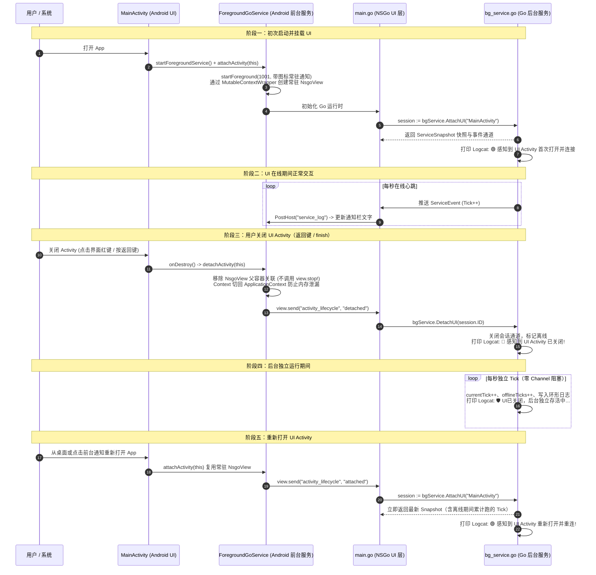

# NSGo 外层 Android 宿主工程 + 前台常驻 Go Service 方案与 Demo

本项目演示如何基于 [NSGo](https://github.com/oneo-me/nsgo) 官方提供的 **`-embed` 嵌入模式** 与 **外层独立 Android 宿主工程**，实现**前台常驻 Go Service** 与 **可随时关闭/重连的 UI Activity**，达成**零侵入 NSGo 引擎源码**的高可用后台常驻架构。

---

## 一、 核心特性与技术亮点

1. **零侵入 NSGo 底层引擎（官方 `-embed` 模式）**：
   - 纯净依赖官方 `github.com/oneo-me/nsgo`，无需魔改底层代码。
   - 通过 `go tool nsgo build -embed` 将 Go 业务编译为标准 Android Archive（`.aar`），输出内置 `libnsgo.so` 原生库与 `dev.oneo.nsgo.NsgoView` 嵌入视图。
2. **Android 14+ 前台服务（Foreground Service）保活**：
   - 适配 Android 14 / API 34 前台服务类型要求（`dataSync`）及 Android 13+ 通知权限（`POST_NOTIFICATIONS`）。
   - 状态栏常驻小图标（`SmallIcon`）与下拉通知栏大图标（`LargeIcon`）均绑定自定义图标资源。
   - 常驻通知附带 `PendingIntent`，点击通知栏可随时重新唤起 UI。
3. **Activity 关闭后 Go 进程持续存活（`MutableContextWrapper` 动态换绑）**：
   - 前台服务 `ForegroundGoService` 长期持有常驻的 `NsgoView` 与 Go 引擎进程。
   - `MainActivity.onDestroy()` 时将 `NsgoView` 从父容器移除，并将 Context 安全切回 `ApplicationContext` 防止内存泄漏，**绝不调用 `view.stop()`**。
   - 通过官方宿主通信桥 `send` / `handle` 通知 Go 侧生命周期状态。
4. **Session Hub 订阅模型替代单一裸 Channel**：
   - 彻底解决单一裸 Channel 在 UI 关闭后无人消费引发的缓冲阻塞或积压问题。
   - 动态订阅：UI 挂载时分配专属会话并返回当前 `ServiceSnapshot` 状态快照；UI 关闭时感知离线，不再向该通道广播。
   - 离线独立运行：Activity 关闭期间，后台 Go Service 继续独立按秒自增 Tick、累计离线运行秒数并记录环形日志。
   - 快速状态恢复：Activity 重新打开时立即下发快照，无缝展示离线期间的所有运行数据与历史日志。
5. **双通道输出到 Android Logcat**：
   - Go 侧标准错误流（`log.Printf`）直通 Android Logcat（Tag: `nsgo`）。
   - Go 侧通过 `cx.PostHost("service_log", msg)` 桥接给外层宿主（Tag: `NSGoService`），并同步刷新状态栏常驻通知内容。

---

## 二、 目录结构说明

```text
nsgodemo/
├── go.mod                        # 纯净依赖官方 github.com/oneo-me/nsgo
├── go.sum
├── nsgo.yaml                     # NSGo 构建配置（应用名、包名、目标架构）
├── FOREGROUND_SERVICE_PLAN.md    # 方案设计规格说明书
├── README.md                     # 本说明文档
├── assets/
│   └── Icon.png                  # 应用与 Android 状态栏前台服务图标
├── resources/
│   └── service_icon.png          # 供 Go UI 界面展示的图标资源
├── service/
│   └── bg_service.go             # Go 后台常驻服务（Session Hub + 状态快照 + 离线独立运行）
├── main.go                       # Go UI 界面（声明式响应式界面 + 宿主事件监听 + 离线快照渲染）
├── main_test.go                  # 单元测试（生命周期仿真：绑定、离线运行、重连快照同步）
└── android/                      # 【外层独立 Android 宿主工程】
    ├── AndroidManifest.xml       # 宿主清单（声明前台服务权限、MainActivity、ForegroundGoService）
    ├── debug.keystore            # 调试签名证书（自动生成）
    ├── res/
    │   └── mipmap-xxxhdpi/
    │       └── ic_launcher.png   # 状态栏前台服务通知图标与桌面启动图标
    ├── src/dev/oneo/nsgo/servicedemo/
    │   ├── ForegroundGoService.java  # Android 前台服务（常驻通知、托管 NsgoView、生命周期换绑）
    │   └── MainActivity.java         # Android UI 界面（轻量挂载视图、关闭时安全解绑）
    └── build_apk.sh              # 一键自动化构建脚本（生成 .aar、编译宿主、D8 合并与 APK 签名）
```

---

## 三、 核心架构与生命周期时序



---

## 四、 快速上手指南

### 1. 环境准备
- **Go**: 1.22+ 且已安装 `nsgo` 命令行工具（`go install github.com/oneo-me/nsgo/cmd/nsgo@latest`）；
- **Android SDK**: API 34（platforms/android-34/android.jar）、Build-Tools 34.0.0+（包含 `aapt2`、`d8`、`zipalign`、`apksigner`）；
- **JDK**: Java 11 / 17 / 21（javac、jar、keytool 可用）；
- **环境变量**: 建议配置 `export ANDROID_HOME=/path/to/android/sdk`。

### 2. 运行 Go 单元测试
项目包含端到端的生命周期单元测试（仿真 Activity 挂载、点击任务、关闭离线、后台持续运行与重连快照恢复）：
```bash
go test -v ./...
```
预期输出：
```text
=== RUN   TestAppAndBackgroundServiceLifecycle
... 🟢 感知到 UI Activity 首次打开并连接 (session#1, MainActivity)
... 📥 [ForegroundService] 收到 UI 动作指令: 用户点击任务 #1
... 🔴 感知到 UI Activity 已关闭 (session#1, MainActivity)! Service 继续在后台存活运行
... 🛡️ [前台Service] UI已关闭，后台独立存活中... Tick: 1 (本次离线已运行 1 秒)
... 🟢 感知到 UI Activity 重新打开并重连 (session#2, 第2次连接, UI关闭期间后台已独立运行 1 Tick)
--- PASS: TestAppAndBackgroundServiceLifecycle (1.21s)
PASS
```

### 3. 一键编译与打包 APK
运行内置打包脚本，自动完成 AAR 构建、外层 AndroidManifest 编译、Java 代码编译、D8 Dex 合并、Native 动态库打包与签名：

```bash
# 针对 x86_64 模拟器打包
bash android/build_apk.sh android_x64

# 针对 ARM64 真机打包
bash android/build_apk.sh android_arm64
```
打包输出物位于：
- `dist/NSGoServiceDemo-android_x64.apk`
- `dist/NSGoServiceDemo-android_arm64.apk`

### 4. 安装与实机/模拟器运行

```bash
# 1. 安装 APK 到设备
adb install -r dist/NSGoServiceDemo-android_x64.apk

# 2. 授予 Android 13+ 通知栏展示权限
adb shell pm grant dev.oneo.nsgo.servicedemo android.permission.POST_NOTIFICATIONS

# 3. 启动应用
adb shell am start -n dev.oneo.nsgo.servicedemo/.MainActivity
```

---

## 五、 调试与验证方法

### 1. 过滤 Logcat 日志
执行以下命令，实时查看 Go 服务生命周期与前台服务通知更新日志：
```bash
adb logcat -v time -s NSGoService:I nsgo:I
```

### 2. 测试场景与验证步骤

| 步骤 | 操作 | 预期现象与 Logcat 证据 |
| :--- | :--- | :--- |
| **1. 启动应用** | 桌面点击图标打开 App | 状态栏出现常驻通知与图标；Logcat 打印 `🟢 感知到 UI Activity 首次打开并连接`，随后每秒自增在线 Tick。 |
| **2. 触发异步任务** | 点击界面蓝色按钮 **⚡ 触发后台异步任务** | Logcat 打印 `📥 收到 UI 动作指令: 用户点击任务 #1`，0.5s 后输出 `✅ 动作处理完成` 并更新界面计数。 |
| **3. 关闭 UI Activity** | 点击界面红色按钮 **🚪 关闭 UI Activity** 或直接按物理返回键 | Activity 退出销毁（`onDestroy`），但通知栏常驻通知保持显示，Logcat 打印 `🔴 感知到 UI Activity 已关闭`；随后每秒持续输出 `🛡️ UI已关闭，后台独立存活中... Tick: N`，离线计时持续累加。 |
| **4. 重新打开 UI** | 点击桌面图标或点击下拉通知栏卡片 | UI 立即秒开复用常驻 Go 进程，Logcat 打印 `🟢 感知到 UI Activity 重新打开并重连 (session#2, UI关闭期间后台已独立运行 N Tick)`；界面上的仪表盘立即同步离线期间后台跑的总 Tick 与日志。 |

### 3. 查看前台通知状态
```bash
adb shell dumpsys notification --noredact | grep -E "pkg=dev.oneo.nsgo.servicedemo" -A 10
```

---

## 六、 关键实现代码解析

### 1. Go 侧 Session Hub（`service/bg_service.go`）
```go
// AttachUI 当 UI Activity 打开或重连时调用，注册专属 channel 并立即生成当前状态快照
func (s *BackgroundService) AttachUI(name string) *UISession {
    s.mu.Lock()
    s.nextSessionID++
    id := s.nextSessionID
    s.attachCount++
    ch := make(chan ServiceEvent, 16)
    s.subscribers[id] = &subscriber{id: id, name: name, ch: ch}
    snap := ServiceSnapshot{
        Tick:         s.currentTick,
        OfflineTicks: s.offlineTicks,
        AttachCount:  s.attachCount,
        UIAttached:   true,
        RecentLogs:   s.cloneLogsLocked(),
    }
    s.mu.Unlock()
    return &UISession{ID: id, Events: ch, Snapshot: snap}
}

// DetachUI 当 UI Activity 关闭时调用，注销会话通道并标记离线
func (s *BackgroundService) DetachUI(sessionID uint64) {
    s.mu.Lock()
    if sub, ok := s.subscribers[sessionID]; ok {
        delete(s.subscribers, sessionID)
        close(sub.ch)
    }
    s.mu.Unlock()
}
```

### 2. Android 侧安全换绑（`android/.../ForegroundGoService.java`）
```java
// 使用 MutableContextWrapper 托管 NsgoView，Activity 销毁时切回 ApplicationContext
public static synchronized void detachActivity(MainActivity activity) {
    if (sharedView != null) {
        ViewParent parent = sharedView.getParent();
        if (parent instanceof ViewGroup) {
            ((ViewGroup) parent).removeView(sharedView);
        }
    }
    if (attachedActivity == activity) {
        attachedActivity = null;
        if (viewContext != null) {
            // 切回 ApplicationContext，防止已销毁的 Activity 发生内存泄漏
            viewContext.setBaseContext(activity.getApplicationContext());
        }
        if (sharedView != null) {
            // 通知 Go 层：UI Activity 已关闭
            sharedView.send("activity_lifecycle", "detached");
        }
    }
}
```

---

## 七、 许可证与参考

- 底层 UI 引擎：[github.com/oneo-me/nsgo](https://github.com/oneo-me/nsgo)
- 详细设计方案：参见 [FOREGROUND_SERVICE_PLAN.md](file:///tmp/ytmp/nsgodemo/FOREGROUND_SERVICE_PLAN.md)
